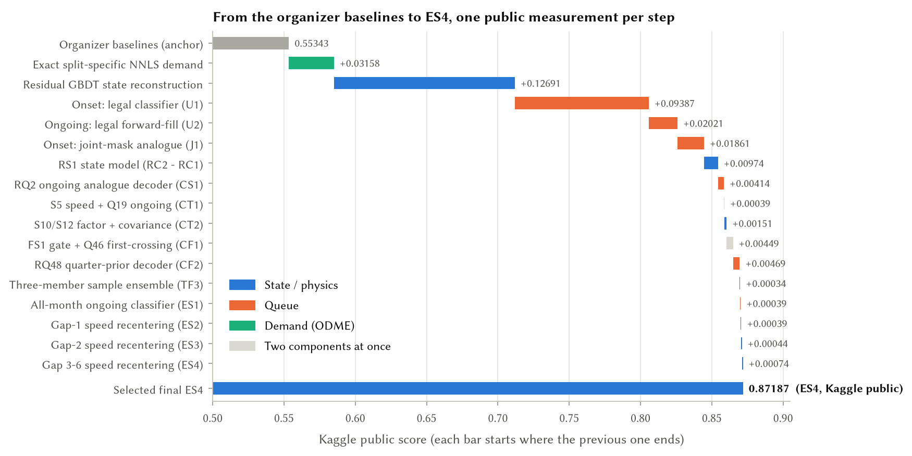
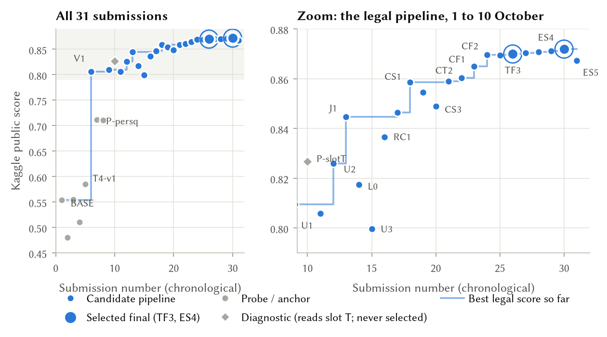
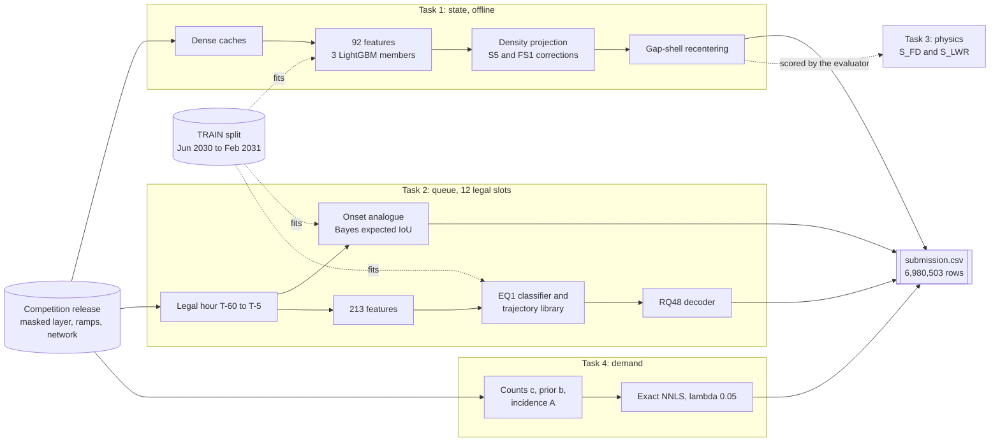
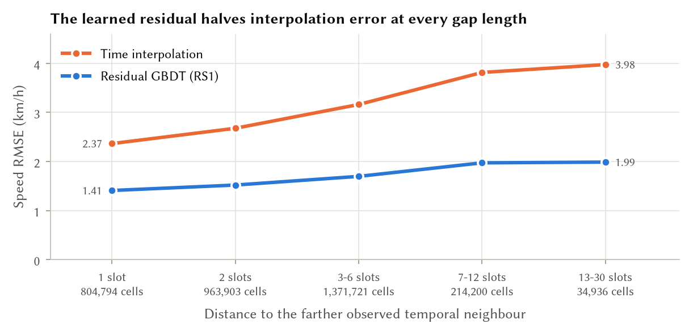
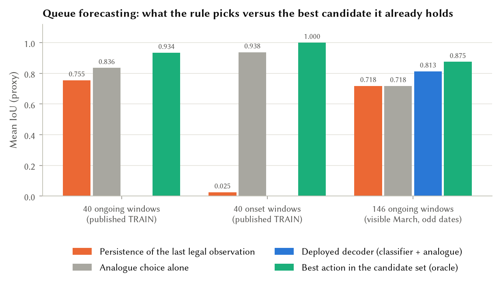

<div align="center">

# TrafficFlowBench: Residual Reconstruction, Analogue Forecasting and Exact Demand Estimation

**Naomi Pereira · Harshendra M**<br>
Department of Information Science and Engineering, Ramaiah Institute of Technology, Bengaluru, India

**Team Powerbuff Girls · 2026 IEEE Big Data Cup · [TrafficFlowBench on Kaggle](https://www.kaggle.com/competitions/2026-ieee-big-data-traffic-flow-bench)**

[](#results)
[](#results)
[](#reproducibility)
[](#environment)
[](#environment)
[](#environment)
[](LICENSE)

**[Final report (PDF, 37 pages)](docs/TrafficFlowBench_Final_Report.pdf)** ·
[Quick start](#quick-start) ·
[Architecture](#architecture) ·
[Method](#method) ·
[Results](#results) ·
[Reproducibility](#reproducibility)

</div>

---

TrafficFlowBench asks for four coupled answers on ten synthetic, physically calibrated freeway corridors:
**reconstruct** masked speed and flow, **forecast** which links will be queued over the next 30 minutes, keep the
reconstruction **consistent** with the fundamental diagram and vehicle conservation, and **recover** path-level demand
from link counts. One number ranks every team:

$$S_{\text{total}} = 0.35\,S_{\text{state}} + 0.30\,S_{\text{queue}} + 0.15\,S_{\text{physics}} + 0.20\,S_{\text{ODME}}$$

This repository contains our two selected submissions, the code and saved weights that regenerate them, and a
37-page research report. The pipeline learns the **residual of temporal interpolation** for state, chooses **whole
queue masks by expected IoU** from training analogues, and solves demand **exactly** on each split's own counts.
We used 31 Kaggle submissions as a **controlled ablation**: because the four tasks are scored on disjoint rows, the
total is exactly additive, and single-task contrasts identify component scores to rounding.

## Contents

- [Results](#results)
- [Key findings](#key-findings)
- [Architecture](#architecture)
- [Method](#method)
- [What did not work](#what-did-not-work)
- [Quick start](#quick-start)
- [Reproducibility](#reproducibility)
- [Rules compliance and information boundaries](#rules-compliance-and-information-boundaries)
- [External data and licence declaration](#external-data-and-licence-declaration)
- [Repository layout](#repository-layout)
- [Building the report and figures](#building-the-report-and-figures)
- [Citation](#citation)
- [Contributing, conduct and licence](#contributing-conduct-and-licence)
- [Team](#team)
- [Acknowledgements](#acknowledgements)

## Results

### Selected submissions

| File | Kaggle ref | Submitted (UTC) | Public score | What it is |
| --- | --- | --- | ---: | --- |
| [`submissions/submission_ES4.zip`](submissions/submission_ES4.zip) | 56998048 | 2026-10-09 07:13 | **0.87187** | TF3 + all-month ongoing-queue classifier + short-gap link-bias recentering |
| [`submissions/submission_TF3.zip`](submissions/submission_TF3.zip) | 56825669 | 2026-10-04 13:51 | 0.86991 | Three-member residual reconstruction, analogue queues, exact demand; regenerates end to end |

Both files have 6,980,503 rows: 6,735,795 state, 174,000 queue and 70,708 ODME. They differ in 5,825,667 speed
values and in all 87,000 ongoing-queue cells; onset labels, flows and path flows are identical. On
**5 November 2026 (12:26 UTC) ES4 ranked 199 of 771 teams** on the public leaderboard. No private score had been
released when this was written. Public scores are Kaggle results; every other number in this repository is a
local proxy and is labelled as one.

### From the organizer baselines to ES4

Every bar below is the difference between two Kaggle public scores, coloured by the task whose rows changed.

<p align="center"></p>

<details>
<summary><b>All 31 submissions over time</b></summary>
<p align="center"></p>

The full table, with references, timestamps and contents, is [`docs/data/submissions.csv`](docs/data/submissions.csv)
and Appendix A of the report.
</details>

### Component scores identified from the leaderboard

With the organizer baseline table as an anchor, single-task contrasts give these public component values (exact up
to Kaggle's five-decimal rounding):

| Task | Method | Public value | Identified from |
| --- | --- | ---: | --- |
| Demand | Organizer NNLS on TRAIN counts → **exact NNLS on the split's own counts** | 0.8359 → **0.9938** | T4-v1 − BASE |
| State | Historical mean → time interpolation → **residual GBDT** | $B$ = 0.2957 → 0.4140 → **0.4226** | L0, P-persq |
| Onset | Persistence → legal classifier → **joint-mask analogue** | IoU ≈ 0 → 0.626 → **0.750** | U1, J1 |
| Ongoing | Organizer persistence → **legal forward-fill** → analogue decoder | IoU 0.603 → **0.738** → 0.766 | U2, CS1 |
| Ongoing | RQ48 decoder, all-month classifier | +0.031, +0.003 IoU | CF2 − CF1, ES1 − TF3 |

$B = 0.35\,S_{\text{state}} + 0.15\,S_{\text{physics}}$. ES4's ongoing IoU is bounded at 0.827–0.832. Report Section 9
has the full derivation.

## Key findings

1. **Learn the residual, not the field.** A tree ensemble on the residual of same-day temporal interpolation roughly
   halves speed error at every mask rate and every gap length on a held-out month. Replacing it by plain
   interpolation costs 0.00867 in public.
2. **Physics is a scoring constraint here, not a better predictor.** Any accurate field already satisfies the
   released diagram ($S_{\text{FD}}$ 0.984–0.994 on every panel). Godunov, steady-flux, diagram-inversion and Newell
   reconstructions all lost on held-out months.
3. **Most queue skill comes from keeping information.** Forward-filling dropped sensors is worth +0.135 ongoing IoU
   and beats a diagnostic that reads slot *T*. Choosing whole onset masks by expected IoU is worth +0.124 over a
   per-link classifier.
4. **The open problem is selection.** On the published ongoing windows the analogue's own candidate set holds a
   mask at 0.934 IoU where its rule picks 0.836. No frozen selection rule we tried closed that gap.
5. **Demand is solved by solving the right system.** Exact NNLS on each split's own counts reaches an implied
   $S_{\text{ODME}}$ of 0.994. Every prior-modelling alternative lost.
6. **State proxies transfer, queue proxies are noisy.** All 6 TRAIN-selected state changes improved the public
   score; only 5 of 10 queue-only changes did. Queue-window sampling alone moves $S_{\text{total}}$ by about 0.0126.

<p align="center"></p>

## Architecture

Three independent lanes produce the three row blocks of the submission. Task 3 has no rows; the evaluator scores it
from the state rows. Nothing flows between lanes, so the offline reconstruction never reaches a queue forecast.

<p align="center"></p>



| Component | Task | Introduced in | Public Δ | TF3 | ES4 |
| --- | --- | --- | ---: | :---: | :---: |
| Exact split-specific NNLS demand | ODME | T4-v1, 29 Sep | +0.03158 | ✓ | ✓ |
| Residual GBDT on temporal interpolation | State | V1, 30 Sep | +0.12691 | RS1 | RS1 |
| Joint-mask onset analogue | Onset | J1, 1 Oct | +0.01861 | ✓ | ✓ |
| Forward-filled persistence | Ongoing | U2, 1 Oct | +0.02021 | candidate | candidate |
| RS1 enhanced residual model + density reconciliation | State | RC2, 2 Oct | +0.00974 | ✓ | ✓ |
| Trajectory-analogue decoder (RQ2) | Ongoing | CS1, 2 Oct | +0.00414 | ✓ | ✓ |
| S5 speed correction, Q19 features | State, ongoing | CT1, 3 Oct | +0.00039 | ✓ | ✓ |
| S10 factor flow, S12 covariance speed | State | CT2, 3 Oct | +0.00151 | ✓ | ✓ |
| FS1 gate, Q46 first-crossing classifier | State, ongoing | CF1, 3 Oct | +0.00449 | ✓ | FS1 only |
| RQ48 quarter-prior decoder | Ongoing | CF2, 3 Oct | +0.00469 | ✓ | ✓ |
| Three-member sample ensemble (TS3) | State | TF3, 4 Oct | +0.00034 | ✓ | ✓ |
| All-month ongoing classifier (EQ1) | Ongoing | ES1, 4 Oct | +0.00039 | | ✓ |
| Gap-shell recentering, shells 1 / 2 / 3–6 | State | ES2–ES4, 4–9 Oct | +0.00157 | | ✓ |

## Method

The report gives the full derivations, hyperparameters and evidence. This is the short version.

### Task 1: state reconstruction

- **Residual target.** For each masked cell we predict $v - \tilde v$ and $q/n_\ell - \tilde q/n_\ell$, where
  $\tilde v, \tilde q$ are same-day linear interpolations between the nearest observed anchors and $n_\ell$ is the lane
  count, so flow is learned in the metric's per-lane units.
- **92 features from the masked layer only:** temporal anchors and gaps, Treiber–Helbing adaptive smoothing along
  free-flow (100 km/h) and congested (−18 km/h) characteristics, weekday × slot TRAIN profiles (own day excluded),
  ramp flows, same-time neighbour states and their interpolation errors at ±1–3 links, multiscale box smooths,
  rank-8 and rank-24 temporal factor reconstructions, occupancy, density and static link context.
- **Learner.** LightGBM with 800 rounds, 255 leaves, learning rate 0.05, minimum leaf 150, feature fraction 0.9,
  bagging 0.8 and $L_2$ 2. Speed and flow use squared error and density uses absolute error. No early stopping. Each
  member trains on up to 600,000 eligible cells per panel (6 M total) from all nine TRAIN months.
- **Density reconciliation.** A half step of the error-weighted projection onto $q = kv$ with scales
  $\sigma_v = 1.5$ km/h and $\sigma_q = 30$ veh/h/lane.
- **Free-branch corrections.** S5 (rank-8 spatial covariance of TRAIN free speeds), S10 (rank-12 TRMF-style factor
  model of the split's own visible flow and occupancy) and S12 (Gaussian conditional
  $v_M = \mu_M - P_{MM}^{-1}P_{MO}(v_O - \mu_O)$), blended at half strength where $v > 0.85\,v_f$ and $q < 0.9$ capacity.
- **TS3 ensemble.** The frozen model and two refits with seeds 20261104 and 20261204, averaged with equal weight.
  The rule was locked on December and January, confirmed once on February (10/10 panels), then refit.
- **Short-gap link-bias recentering (ES4 only).** On February, the same-day interpolant is unbiased per link on short
  gaps (mean |bias| 0.02–0.11 km/h). On a gap shell $G$ we therefore estimate the model's link bias without labels,
  $\delta_\ell = \operatorname{mean}_{G}(\hat v - \tilde v)$, and subtract it. Shells of 1, 2 and 3–6 slots passed the
  pre-set gate and added +0.00157 in public.

<p align="center"></p>

### Task 3: physics consistency

There is no physics file. $S_{\text{physics}} = \tfrac13 S_{\text{FD}} + \tfrac23 S_{\text{LWR}}$ is computed from the
state rows. The diagram term is saturated by any accurate field. The conservation term needs boundary flows that
are withheld, so it cannot be scored locally. Every attempt to impose kinematic-wave physics lost to temporal
evidence on held-out months: a 0.245 s Godunov solver, steady flux, diagram inversion, Newell envelopes and
occupancy-based density. The masked holes are one to five links long, and a fine-step solver crosses them inside
a single five-minute bin.

### Task 2: queue forecasting

Every forecast reads **exactly the twelve legal slots** $T-60,\dots,T-5$ of its own window, plus static network data
and TRAIN-fitted models.

- **Onset (J1).** Training onset events within ±30 minutes of the origin and of the same day type are retrieved. The
  ten nearest are found by standardized distance over 13 descriptors of the legal hour. The rule then picks the
  candidate mask, a neighbour outcome or a top-*k* marginal mask, that maximizes the empirical expected IoU
  against the neighbours' outcomes. The mask is placed at $T+30$, where the selector puts onsets.
- **Ongoing.** An EQ1 LightGBM classifier (213 features, 800 trees, 3,766 first-crossing TRAIN windows) gives
  $p(\ell,h)$. A TRAIN trajectory library supplies 20 donor futures. The decoder chooses among up to 34 complete masks:

  $$\hat a = \arg\max_{a}\; 0.25\,\widehat{\text{IoU}}_{\text{emp}}(a) + 0.75\,\frac{\sum_i a_i p_i}{\sum_i a_i + \sum_i p_i - \sum_i a_i p_i}$$

<p align="center"></p>

### Task 4: path-flow and OD estimation

$$f^\star = \arg\min_{f \ge 0} \lVert Af - c\rVert_2^2 + 0.05\,\lVert f - b\rVert_2^2$$

This is solved exactly as one NNLS problem on the stacked system $[A;\sqrt{\lambda} I]$, separately for each split with
its own counts $c$ and prior $b$. The result is byte-identical to the organizer builder's `public_reference.csv`.

## What did not work

More than thirty branches were rejected by pre-registered gates. Report Section 10 lists them all. A selection:

| Idea | Evidence | Decision |
| --- | --- | --- |
| Speed model fitted on visible March cells (ES5) | visible RMSE 2.545 → 2.006, **public −0.00462** | rejected |
| Onset frequency prior (U3) | leave-month-out 0.558, **public onset IoU 0.626 → 0.450** | rejected |
| Occupancy-aware ongoing classifier (CF3) | +0.0074 to +0.0085 March proxy, **public −0.0001** | rejected |
| Fine-step Godunov LWR reconstruction | state piece 0.813 vs interpolation 0.904 | rejected |
| Newell lower envelope of cumulative counts | speed RMSE 79.0 vs 1.60 km/h | rejected |
| Rerankers over the decoder's candidate masks | +0.004 to +0.009 vs a 0.02–0.03 bar | failed gate |
| Prior modelling for demand (gravity, entropy, smooth distortion) | implied $S_{\text{ODME}}$ 0.47–0.84 vs 0.994 | rejected |

## Quick start

### Prerequisites

- **Python 3.12** (the reference run used 3.12.3 on Linux).
- **[Git LFS](https://git-lfs.com)**. The submission archives and the inference bundle are stored with LFS.
- **The competition release** for regeneration, downloaded from the Kaggle data page. It is not redistributed
  here. `--release-root` is the directory that contains `submission_key.csv`, `corridors/` and `task2/`.
- A multi-core CPU. No GPU is used.

### Install

```bash
git lfs install
git clone https://github.com/NaomiiAP/ieee-traffic.git
cd ieee-traffic
python -m venv .venv && source .venv/bin/activate    # Windows: .venv\Scripts\activate
python -m pip install -r requirements.txt
```

### 1. Verify the selected files (standard library only, seconds)

```bash
python reproduce.py
```

```text
TF3  ref 56825669  public 0.86991  sha256 2ae94d422399c7248297487fc8f45d737de0e024fbad32b6a360c290bbabca7a  OK
ES4  ref 56998048  public 0.87187  sha256 ce03386b42e33bc6c726b09c0b64b791f294ea3abeb88d7e310552bb080c04bb  OK
TF3-CODE  sha256 dce93b3f2a38d27014497ec1a563cc1e2d032da11c499234f226c72093678cd7  OK
```

### 2. Regenerate TF3 from the raw release

```bash
python reproduce.py --submission tf3 \
  --release-root /path/to/kaggle_release \
  --out /path/to/new_tf3_run \
  --threads 6
```

This extracts `vendor/reproduction_TF3.zip`, rebuilds every cache from the release, runs saved-weight inference for
all four tasks and writes `submission_TF3_reproduced.csv` together with a `full_reproduction.json` of hashes and
settings. It never calls Kaggle. The output directory must not exist yet.

### 3. Regenerate the last ES4 shell

```bash
python reproduce.py --submission es4 \
  --release-root /path/to/kaggle_release \
  --parent /path/to/submission_ES3.zip \
  --out /path/to/new_es4_run
```

`code/recenter_short_gaps.py` applies the gap 3–6 recentering to its parent, ES3. It builds the dense caches it
needs under `<out>/cache` (or `--cache-root`). Other shells can be applied with `--shells`, for example `1,2,3-6`.

## Reproducibility

### What has been verified

| Claim | Status |
| --- | --- |
| Archive checksums of TF3, ES4 and the TF3 bundle | Verified by `python reproduce.py` (re-run 5 Nov 2026) |
| TF3 regenerated from the raw release and saved weights | **All 6,980,503 rows match; queues exact; max continuous difference 1.82 × 10⁻¹²** (clean run, 4 Oct 2026, fresh pinned environment, every cache rebuilt) |
| ES4 | The uploaded archive is in `submissions/`. Its final gap 3–6 shell regenerates from ES3 with `code/recenter_short_gaps.py` |
| Retraining from scratch | The procedure, seeds and inventories are recorded in the bundle's manifests. Saved-weight inference is what was verified, not an independent retrain |

> **Scope.** The intermediate archives ES1–ES3 and the all-month ongoing classifier EQ1 are not stored in this
> repository, so ES4 cannot be regenerated end to end from the release with this repository alone. TF3 can, and it
> scored 0.00196 (0.22 %) below ES4 in public.

### Environment

| Package | Version | Licence |
| --- | --- | --- |
| numpy | 2.5.3 | BSD-3-Clause |
| pandas | 3.0.6 | BSD-3-Clause |
| scipy | 1.18.1 | BSD-3-Clause |
| pyarrow | 25.0.1 | Apache-2.0 |
| lightgbm | 4.7.0 | MIT |
| scikit-learn | 1.9.1 | BSD-3-Clause |

**Hardware and runtime.** All production runs used one AWS EC2 `r7i.2xlarge` (8 vCPU, 64 GiB RAM, Ubuntu with
glibc 2.39). The clean TF3 regeneration took **1 h 33 min** with `--threads 6` (12:15:17 to 13:48:28 UTC, 4 October
2026), including rebuilding every cache from the release. Leave ample free disk for the release and the caches;
the reference instance had about 70 GiB free.

### Seeds

| Component | Seed |
| --- | --- |
| TS3 members | 20261104 and 20261204, each plus the panel index, as `random_state` for row sampling |
| RS1 development samples | 20261001 plus the panel index |
| EQ1 extra training windows | 20261240 plus the panel index |

### Checksums

| Artefact | SHA256 |
| --- | --- |
| `submissions/submission_TF3.zip` | `2ae94d422399c7248297487fc8f45d737de0e024fbad32b6a360c290bbabca7a` |
| `submissions/submission_ES4.zip` | `ce03386b42e33bc6c726b09c0b64b791f294ea3abeb88d7e310552bb080c04bb` |
| `vendor/reproduction_TF3.zip` | `dce93b3f2a38d27014497ec1a563cc1e2d032da11c499234f226c72093678cd7` |
| TS3 frozen rule | `61499049f1cced66927eff4c9e9c99bb611093c33c3a31de98ebd436940883d5` |
| TS3 final model manifest | `8ed505b54215cd88706e95dedc5b4fbee3f435e228560f8d71d018b546cf6acb` |
| Q46 ongoing classifier (TF3) | `2816e1d3f3c233416327591c6659cd9e80a25f0054431f1b1d4ee23735b2ab46` |
| EQ1 ongoing classifier (ES4) | `cb626813e621064594f6956344df81d7d8879e65ebc23ae2f164a2f8f6f9ac9f` |

### Release discipline

Every candidate from RC1 to TF3 passed three checks before its single upload: an independent full-row parser,
a clean regeneration from the raw release that matched every queue label exactly and every continuous value to
within $10^{-8}$, and a recorded SHA256 with an exclusive attempt marker. The later ES files each change one column
of a frozen, hash-verified parent and were checked by row-level difference against it. No file was uploaded twice,
and every score was confirmed by a separate read-only listing.

## Rules compliance and information boundaries

| Task | Allowed by the rules | Used by the selected files |
| --- | --- | --- |
| 1 · State | Any released observation of the split, any time; TRAIN in full | The split's masked layer (target channels absent); TRAIN-fitted models |
| 2 · Queue | Released data stamped at or before *T* | **Exactly** $T-60 \dots T-5$ of the window, static network, TRAIN-fitted classifier and library |
| 3 · Physics | No rows | — |
| 4 · ODME | The split's counts, prior and incidence | The same, each split solved on its own data |

- Our Task 2 contract is **stricter than the rules**. It does not read slot *T*, other evaluation days or windows,
  same-day data before $T-60$, ramp values after *T*, or the offline state reconstruction.
- One early diagnostic file (`P-slotT`, 30 September) read slot *T* to measure its value. It was never a candidate
  and is in neither selected file.
- No validation or private label was used. All submissions were made after the 11 September data rebuild.

## External data and licence declaration

- **External data:** none. No external dataset, pretrained model, paid or rate-limited API, or proprietary
  dependency was used.
- **Competition data:** used under the competition rules and **not redistributed**. The network-derived statistics
  and figures in the report are summaries.
- **Software:** open source only (table above). The documentation tooling, Matplotlib and PyMuPDF for figures and
  LaTeX (MiKTeX) for the report, is not needed for inference.
- **Our code and documentation:** [MIT licence](LICENSE). The organizer-provided `repo/src/merge_submissions.py`
  inside the bundle is the organizers' MIT-licensed helper.

## Repository layout

```text
.
├── reproduce.py                    # single entry point: verify, regenerate TF3, regenerate the ES4 shell
├── requirements.txt                # pinned inference environment
├── submissions/                    # the two selected Kaggle archives (Git LFS)
│   ├── submission_TF3.zip
│   └── submission_ES4.zip
├── vendor/
│   └── reproduction_TF3.zip        # frozen TF3 inference code, 92 saved models, evidence, manifest (Git LFS)
├── code/
│   └── recenter_short_gaps.py      # the ES4 short-gap speed edit
├── tfb/                            # research toolkit (see below)
├── docs/
│   ├── TrafficFlowBench_Final_Report.pdf   # the final report
│   ├── report/                     # LaTeX source: main.tex, sections/, references.bib, figures/, generated/
│   ├── figures/                    # PNG figures used in this README
│   ├── data/                       # submission ledger and anonymized public-leaderboard scores
│   └── scripts/                    # make_figures.py, render_architecture.py
├── LICENSE · CITATION.cff · CODE_OF_CONDUCT.md · CONTRIBUTING.md
└── .github/                        # issue and pull-request templates
```

<details>
<summary><b>Inside <code>vendor/reproduction_TF3.zip</code></b></summary>

| Path | Role |
| --- | --- |
| `tfb/research_transfer_bagged_state_reproduce.py` | Default inference driver called by `reproduce.py` |
| `tfb/cache.py`, `tfb/research_rebuild_cache.py` | Dense `[D, 288, L]` caches from the raw release |
| `tfb/t1_features.py`, `tfb/research_state_model.py`, `tfb/research_state_final.py` | State features, residual models, density reconciliation |
| `tfb/research_transfer_bagged_state*.py` | TS3 ensemble fit, freeze, production and checks |
| `tfb/research_spatial_covariance.py`, `tfb/research_temporal_logflow.py`, `tfb/research_temporal_state_build.py` | S12 covariance, S10 factor model, FS1 gate |
| `tfb/t2_joint_prior.py` | J1 joint-mask onset analogue |
| `tfb/research_transport_queue.py`, `tfb/research_first_crossing_queue.py` | Ongoing features and first-crossing training population |
| `tfb/research_queue_analog.py`, `tfb/research_queue_ensemble.py`, `tfb/research_reopened_decoder.py` | Trajectory library, candidate pool, RQ48 decoder |
| `tfb/research_reproduce_components.py` | ODME NNLS solve and component assembly |
| `models/` | 92 saved artefacts: state trees, factors, S5/S12 covariances, TS3 members, Q46 classifier |
| `inference.json`, `manifest.json`, `evidence/`, `lineage/` | Pinned model hashes, archive manifest, gate and audit records |

List it with `python -m zipfile -l vendor/reproduction_TF3.zip`.
</details>

<details>
<summary><b>The <code>tfb/</code> research toolkit</b></summary>

These modules record the exploratory work of the first days. They are not needed to verify or regenerate the
selected files.

| Prefix | Purpose |
| --- | --- |
| `cache.py`, `score_local.py`, `legal.py` | Dense caches, local scorers validated against the official ones, information-contract checks |
| `t1_*` | Task 1 baselines, features, residual GBDT, ablations, Newell and projection experiments |
| `t2*`, `growth.py` | Task 2 selector analysis, persistence variants, onset priors, oracles, leakage checks |
| `t3_*` | Physics-proxy validation against the official Task 3 scorer |
| `t4_*` | Task 4 forensics, gravity and structural fits, NNLS builder |
| `twin*.py` | Cell-transmission-model digital-twin experiments |
| `build_*`, `freeze_j1.py`, `*.sh` | Historical candidate builders and job scripts |
| `arch_c_*`, `*_frontier.py` | Architecture-C and score-frontier experiments |
</details>

## Building the report and figures

```bash
# figures and generated tables (needs matplotlib; the FD figure also needs the release network files)
python docs/scripts/make_figures.py --network-root /path/to/kaggle_release

# the report (any TeX distribution with pdflatex, bibtex and the libertinus fonts)
cd docs/report
pdflatex main && bibtex main && pdflatex main && pdflatex main
cp main.pdf ../TrafficFlowBench_Final_Report.pdf

# the README architecture image
pdflatex architecture_standalone && python ../scripts/render_architecture.py
```

Every number in the figures and generated tables comes from `docs/data/` or from a constant in
`make_figures.py` that names the research-ledger entry it was taken from.

## Citation

If you use this work, please cite the report (see [`CITATION.cff`](CITATION.cff)) and the benchmark:

```bibtex
@techreport{powerbuffgirls2026tfb,
  title       = {Residual Reconstruction, Analogue Forecasting and Exact Demand Estimation for Freeway Traffic:
                 Final Report of Team Powerbuff Girls, TrafficFlowBench},
  author      = {Pereira, Naomi and {Harshendra M}},
  institution = {2026 IEEE Big Data Cup},
  year        = {2026},
  month       = nov,
  url         = {https://github.com/NaomiiAP/ieee-traffic}
}

@misc{tfb2026,
  title        = {{TrafficFlowBench}: a four-task freeway traffic benchmark},
  author       = {Wu, Jinxi and {TrafficFlowBench organizers}},
  year         = {2026},
  howpublished = {\url{https://github.com/jacky850/trafficflowbench-public}}
}
```

## Contributing, conduct and licence

- Contributions are welcome after the competition. Read [`CONTRIBUTING.md`](CONTRIBUTING.md) first: it explains the
  frozen artefacts, the information-boundary rules and the evidence a pull request needs.
- Everyone taking part is expected to follow the [Code of Conduct](CODE_OF_CONDUCT.md).
- The code and documentation are released under the [MIT licence](LICENSE). The competition data is not, and is not
  included.

## Team

**Powerbuff Girls** is a two-person team of fourth-year undergraduate students in the Department of Information
Science and Engineering at Ramaiah Institute of Technology, Bengaluru, India.

| Member | Kaggle account | Affiliation |
| --- | --- | --- |
| Naomi Pereira | [`naomiandreapereira`](https://www.kaggle.com/naomiandreapereira) | Information Science and Engineering (4th year), Ramaiah Institute of Technology, Bengaluru |
| Harshendra M | [`hersheyz`](https://www.kaggle.com/hersheyz) | Information Science and Engineering (4th year), Ramaiah Institute of Technology, Bengaluru |

## Acknowledgements

We thank the TrafficFlowBench organizers and the 2026 IEEE Big Data Cup co-chairs for a carefully built,
reproducible benchmark. The challenge is organized by the **IEEE ITS Society Technical Committee on Travel Information
and Traffic Management** with **RERITE** (REproducible Research In Transportation Engineering). We also thank the
maintainers of NumPy, pandas, SciPy, PyArrow, LightGBM and scikit-learn.

<div align="center">
<sub>Naomi Pereira and Harshendra M · Team <b>Powerbuff Girls</b> · Ramaiah Institute of Technology, Bengaluru ·
final package e-mail subject: <i>Traffic Flow Bench Final Package – Powerbuff Girls</i></sub>
</div>
