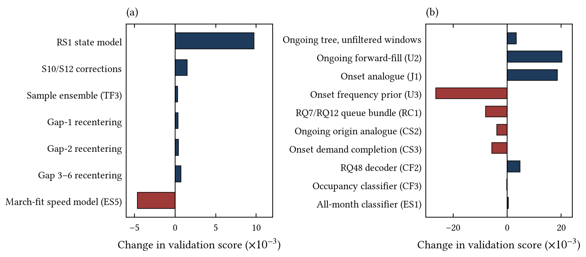
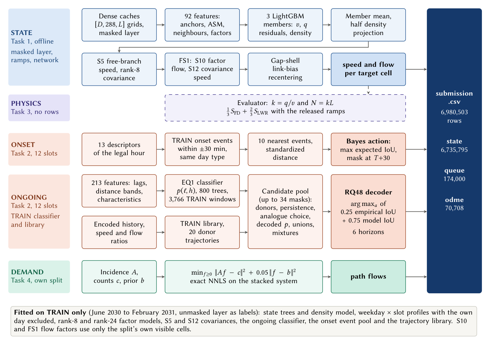
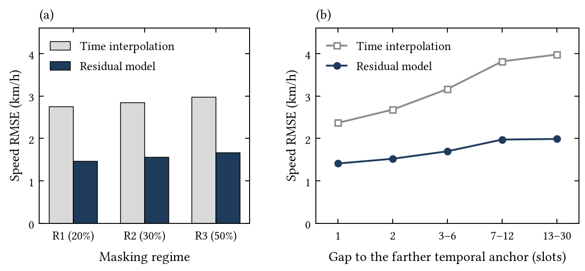
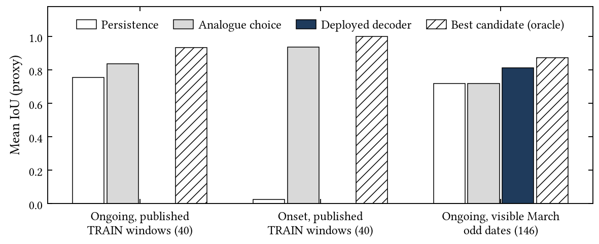

<div align="center">

# Residual Reconstruction, Analogue Forecasting and Exact Demand Estimation for Freeway Traffic

**Naomi Pereira · Harshendra M**<br>
Department of Information Science and Engineering, Ramaiah Institute of Technology, Bengaluru, India

Team Powerbuff Girls · 2026 IEEE Big Data Cup · [TrafficFlowBench](https://www.kaggle.com/competitions/2026-ieee-big-data-traffic-flow-bench)

[](#environment)
[](#environment)
[](#environment)
[](LICENSE)

**[Final report (PDF)](docs/TrafficFlowBench_Final_Report.pdf)** ·
[Quick start](#quick-start) ·
[Architecture](#architecture) ·
[Method](#method) ·
[Results](#results) ·
[Reproducibility](#reproducibility)

</div>

---

TrafficFlowBench asks for four coupled answers on ten synthetic, physically calibrated freeway corridors:
**reconstruct** masked speed and flow, **forecast** which links will be queued over the next 30 minutes, keep the
reconstruction **consistent** with the fundamental diagram and vehicle conservation, and **recover** path-level demand
from link counts. A single composite score evaluates all four tasks:

$$S_{\text{total}} = 0.35\,S_{\text{state}} + 0.30\,S_{\text{queue}} + 0.15\,S_{\text{physics}} + 0.20\,S_{\text{ODME}}$$

This repository contains our two final submissions, the code and saved weights that regenerate them, and the final
report. The pipeline learns the **residual of temporal interpolation** for the traffic state, chooses **whole queue
masks by expected IoU** from training analogues, and solves the demand system **exactly** on each split's own counts.
Because the four tasks are scored on disjoint rows, the composite score is exactly additive, and we used our evaluated
submissions as a controlled ablation that identifies the score of each component.

## Contents

- [Results](#results)
- [Key findings](#key-findings)
- [Architecture](#architecture)
- [Method](#method)
- [What did not work](#what-did-not-work)
- [Quick start](#quick-start)
- [Reproducibility](#reproducibility)
- [Rules compliance and information boundaries](#rules-compliance-and-information-boundaries)
- [External data and licence declaration](#external-data-and-licence-declaration)
- [Repository layout](#repository-layout)
- [Building the report and figures](#building-the-report-and-figures)
- [Citation](#citation)
- [Contributing, conduct and licence](#contributing-conduct-and-licence)
- [Team](#team)
- [Acknowledgements](#acknowledgements)

## Results

### Final submissions

| File | Content | Validation score |
| --- | --- | ---: |
| [`submissions/submission_ES4.zip`](submissions/submission_ES4.zip) | TF3 with an all-month ongoing-queue classifier and short-gap link-bias recentering | 0.87187 |
| [`submissions/submission_TF3.zip`](submissions/submission_TF3.zip) | Three-member residual reconstruction, analogue queues, exact demand; regenerates end to end | 0.86991 |

Both files have 6,980,503 rows: 6,735,795 state, 174,000 queue and 70,708 ODME. They differ in 5,825,667 speed
values and in 247 ongoing-queue labels; onset labels, flows and path flows are identical. Validation scores
are those returned by the evaluation platform for the March month; every other number in this repository is a local
proxy and is labelled as one.

> **Reproducing these files:** [REPRODUCIBILITY.md](REPRODUCIBILITY.md) is the full written account, covering runtime,
> hardware, why the method cannot run in a Kaggle Notebook, versions, preprocessing, seeds, licences and commands.

### Decomposition of the improvement

Each step is the difference between two validation scores. Two steps changed two components at once, and the RS1 and
RQ2 steps follow from additivity.

| Step | Change | Rows changed | Δ score |
| ---: | --- | --- | ---: |
| 0 | Organizer baselines (anchor, 0.55343) | all | |
| 1 | Exact split-specific NNLS demand | Demand | +0.03158 |
| 2 | Residual GBDT state reconstruction | State | +0.12691 |
| 3 | Twelve-slot onset classifier (U1) | Onset | +0.09387 |
| 4 | Forward-filled ongoing persistence (U2) | Ongoing | +0.02021 |
| 5 | Joint-mask onset analogue (J1) | Onset | +0.01861 |
| 6 | RS1 state model | State | +0.00974 |
| 7 | RQ2 ongoing analogue decoder | Ongoing | +0.00414 |
| 8 | S5 speed correction and Q19 features (CT1) | State, ongoing | +0.00039 |
| 9 | S10 factor flow and S12 covariance speed (CT2) | State | +0.00151 |
| 10 | FS1 gate and Q46 first-crossing classifier (CF1) | State, ongoing | +0.00449 |
| 11 | RQ48 quarter-prior decoder (CF2) | Ongoing | +0.00469 |
| 12 | Three-member sample ensemble (TF3) | State | +0.00034 |
| 13 | All-month ongoing classifier (ES1) | Ongoing | +0.00039 |
| 14 | Gap-1 speed recentering (ES2) | State | +0.00039 |
| 15 | Gap-2 speed recentering (ES3) | State | +0.00044 |
| 16 | Gap 3–6 speed recentering (ES4) | State | +0.00074 |

### Component scores identified from validation scores

With the organizers' baseline table as an anchor, single-task contrasts identify these component values (exact up
to five-decimal rounding):

| Task | Method | Value | Identified from |
| --- | --- | ---: | --- |
| Demand | Organizer NNLS on TRAIN counts → **exact NNLS on the split's own counts** | 0.8359 → **0.9938** | T4-v1, BASE |
| State | Historical mean → time interpolation → **residual GBDT** | $B$ = 0.2957 → 0.4140 → **0.4226** | L0, P-persq |
| Onset | Persistence → twelve-slot classifier → **joint-mask analogue** | IoU ≈ 0 → 0.626 → **0.750** | U1, J1 |
| Ongoing | Organizer persistence → **forward-fill** → analogue decoder | IoU 0.603 → **0.738** → 0.766 | U2, CS1 |
| Ongoing | RQ48 decoder, all-month classifier | +0.031, +0.003 IoU | CF2, CF1, ES1, TF3 |

$B = 0.35\,S_{\text{state}} + 0.15\,S_{\text{physics}}$. ES4's ongoing IoU is bounded between 0.827 and 0.832.
Section 9 of the report gives the full derivation.

## Key findings

1. **Learn the residual, not the field.** A tree ensemble trained on the residual of same-day temporal interpolation
   roughly halves speed error at every mask rate and every gap length on a held-out month. Replacing it by plain
   interpolation lowers the validation score by 0.00867.
2. **Physics is a scoring constraint here, not a better predictor.** Any accurate field already satisfies the
   released diagram ($S_{\text{FD}}$ between 0.984 and 0.994 on every panel). Godunov, steady-flux,
   diagram-inversion and Newell reconstructions all lost on held-out months.
3. **Most queue skill comes from retaining information.** Forward-filling dropped sensors raises ongoing IoU by
   0.135, and choosing whole onset masks by expected IoU raises onset IoU by 0.124 over a per-link classifier.
4. **The open problem is selection.** On the published ongoing windows the analogue's candidate set contains a mask
   scoring 0.934 IoU while its rule selects one scoring 0.836. No frozen selection rule we tested closed that gap.
5. **Demand is solved by solving the right system.** Exact NNLS on each split's own counts reaches an implied
   $S_{\text{ODME}}$ of 0.994; every prior-modelling alternative was worse.
6. **State proxies transfer; queue proxies are noisy.** All six state changes selected on held-out training months
   improved the validation score, whereas only five of ten queue changes did. Queue-window sampling alone has a
   standard deviation of about 0.0126 in $S_{\text{total}}$.

<p align="center"></p>

## Architecture

Three independent lanes produce the three row blocks of the submission file. Task 3 has no rows; the evaluator
computes it from the state rows. No information flows between lanes, so the offline reconstruction never reaches a
queue forecast. Every learned artefact is fitted on the training split.

<p align="center"></p>

| Component | Task | Introduced in | Δ score | TF3 | ES4 |
| --- | --- | --- | ---: | :---: | :---: |
| Exact split-specific NNLS demand | ODME | T4-v1 | +0.03158 | ✓ | ✓ |
| Residual GBDT on temporal interpolation | State | V1 | +0.12691 | RS1 | RS1 |
| Joint-mask onset analogue | Onset | J1 | +0.01861 | ✓ | ✓ |
| Forward-filled persistence | Ongoing | U2 | +0.02021 | candidate | candidate |
| RS1 residual model with density reconciliation | State | RC2 | +0.00974 | ✓ | ✓ |
| Trajectory-analogue decoder (RQ2) | Ongoing | CS1 | +0.00414 | ✓ | ✓ |
| S5 speed correction and Q19 features | State, ongoing | CT1 | +0.00039 | ✓ | ✓ |
| S10 factor flow and S12 covariance speed | State | CT2 | +0.00151 | ✓ | ✓ |
| FS1 gate and Q46 first-crossing classifier | State, ongoing | CF1 | +0.00449 | ✓ | FS1 only |
| RQ48 quarter-prior decoder | Ongoing | CF2 | +0.00469 | ✓ | ✓ |
| Three-member sample ensemble (TS3) | State | TF3 | +0.00034 | ✓ | ✓ |
| All-month ongoing classifier (EQ1) | Ongoing | ES1 | +0.00039 | | ✓ |
| Gap-shell recentering, shells 1, 2 and 3–6 | State | ES2 to ES4 | +0.00157 | | ✓ |

## Method

The report gives the full derivations, hyperparameters and evidence. This is a summary.

### Task 1: state reconstruction

- **Residual target.** For each masked cell we predict $v - \tilde v$ and $q/n_\ell - \tilde q/n_\ell$, where
  $\tilde v, \tilde q$ are same-day linear interpolations between the nearest observed anchors and $n_\ell$ is the lane
  count, so that flow is learned in the per-lane units of the metric.
- **92 features from the masked layer only:** temporal anchors and gaps, Treiber–Helbing adaptive smoothing along
  free-flow (100 km/h) and congested (−18 km/h) characteristics, weekday × slot TRAIN profiles (own day excluded),
  ramp flows, same-time neighbour states and their interpolation errors at ±1 to ±3 links, multiscale box smooths,
  rank-8 and rank-24 temporal factor reconstructions, occupancy, density and static link context.
- **Learner.** LightGBM with 800 rounds, 255 leaves, learning rate 0.05, minimum leaf size 150, feature fraction
  0.9, bagging fraction 0.8 and $L_2$ penalty 2. Speed and flow use squared error and density uses absolute error,
  without early stopping. Each member trains on up to 600,000 eligible cells per panel (six million in total) from all
  nine TRAIN months.
- **Density reconciliation.** A half step of the error-weighted projection onto $q = kv$, with scales
  $\sigma_v = 1.5$ km/h and $\sigma_q = 30$ veh/h/lane.
- **Free-branch corrections.** S5 (rank-8 spatial covariance of TRAIN free-flow speeds), S10 (rank-12 temporally
  regularized factor model of the split's own visible flow and occupancy) and S12 (Gaussian conditional
  $v_M = \mu_M - P_{MM}^{-1}P_{MO}(v_O - \mu_O)$), blended at half strength where $v > 0.85\,v_f$ and $q < 0.9$ of
  capacity.
- **TS3 ensemble.** The frozen model and two refits with seeds 20261104 and 20261204, averaged with equal weight. The
  rule was fixed on December and January, confirmed once on February (10 of 10 panels improved) and then refitted.
- **Short-gap link-bias recentering (ES4 only).** On February, the same-day interpolant is unbiased per link on short
  gaps (mean absolute bias 0.02 to 0.11 km/h). On a gap shell $G$ we therefore estimate the model's link bias without
  labels, $\delta_\ell = \operatorname{mean}_{G}(\hat v - \tilde v)$, and subtract it. Shells of 1, 2 and 3 to 6 slots
  passed the pre-set test and together raised the validation score by 0.00157.

<p align="center"></p>

### Task 3: physics consistency

There is no physics file. $S_{\text{physics}} = \tfrac13 S_{\text{FD}} + \tfrac23 S_{\text{LWR}}$ is computed from the
state rows. The diagram term is saturated by any accurate field, and the conservation term needs boundary flows that
are withheld, so it cannot be scored locally. Every attempt to impose kinematic-wave physics lost to temporal
evidence on held-out months: a 0.245 s Godunov solver, steady flux, diagram inversion, Newell envelopes and
occupancy-based density. The masked holes are one to five links long, and a fine-step solver crosses them within a
single five-minute bin.

### Task 2: queue forecasting

Every forecast reads **exactly the twelve history slots** $T-60,\dots,T-5$ of its own window, together with static
network data and models fitted on the training split.

- **Onset (J1).** Training onset events within ±30 minutes of the origin and of the same day type are retrieved, and
  the ten nearest are selected by standardized distance over 13 descriptors of the history. The rule then chooses the
  candidate mask (a neighbour outcome or a top-*k* marginal mask) that maximizes the empirical expected IoU against the
  neighbours' outcomes. The mask is placed at $T+30$, where the window selector places onsets.
- **Ongoing.** The EQ1 LightGBM classifier (213 features, 800 trees, 3,766 first-crossing TRAIN windows) gives
  $p(\ell,h)$, and a TRAIN trajectory library supplies 20 donor futures. The decoder chooses among up to 34 complete
  masks, with $J$ denoting an estimate of the Jaccard index (IoU):

  $$\hat a = \arg\max_{a}\; 0.25\,J_{\text{emp}}(a) + 0.75\,\frac{\sum_i a_i p_i}{\sum_i a_i + \sum_i p_i - \sum_i a_i p_i}$$

<p align="center"></p>

### Task 4: path-flow and OD estimation

$$f^\star = \arg\min_{f \ge 0} \lVert Af - c\rVert_2^2 + 0.05\,\lVert f - b\rVert_2^2$$

The problem is solved exactly as one NNLS problem on the stacked system $[A;\sqrt{\lambda} I]$, separately for each
split with its own counts $c$ and prior $b$. The result is byte-identical to the `public_reference.csv` produced by the
organizers' builder.

## What did not work

More than thirty approaches were rejected by pre-registered tests; Section 10 of the report lists them all. A
selection:

| Approach | Evidence | Decision |
| --- | --- | --- |
| Speed model fitted on visible March cells (ES5) | visible RMSE 2.545 → 2.006; validation −0.00462 | rejected |
| Onset frequency prior (U3) | leave-one-month-out 0.558; validation onset IoU 0.626 → 0.450 | rejected |
| Occupancy-aware ongoing classifier (CF3) | +0.0074 to +0.0085 on the March proxy; validation −0.0001 | rejected |
| Fine-step Godunov LWR reconstruction | state piece 0.813 against interpolation 0.904 | rejected |
| Newell lower envelope of cumulative counts | speed RMSE 79.0 against 1.60 km/h | rejected |
| Rerankers over the decoder's candidate masks | +0.004 to +0.009 against a 0.02 to 0.03 threshold | failed test |
| Prior modelling for demand (gravity, entropy, smooth distortion) | implied $S_{\text{ODME}}$ 0.47 to 0.84 against 0.994 | rejected |

## Quick start

### Prerequisites

- **Python 3.12** (the reference run used 3.12.3 on Linux).
- **[Git LFS](https://git-lfs.com)**. The submission archives and the inference bundle are stored with LFS.
- **The competition release**, downloaded from the competition data page. It is not redistributed here.
  `--release-root` is the directory that contains `submission_key.csv`, `corridors/` and `task2/`.
- A multi-core CPU. No GPU is used.

### Install

```bash
git lfs install
git clone https://github.com/NaomiiAP/ieee-traffic.git
cd ieee-traffic
python -m venv .venv && source .venv/bin/activate    # Windows: .venv\Scripts\activate
python -m pip install -r requirements.txt
```

### 1. Verify the final archives (standard library only)

```bash
python reproduce.py
```

```text
TF3       sha256 2ae94d422399c7248297487fc8f45d737de0e024fbad32b6a360c290bbabca7a  OK
ES4       sha256 ce03386b42e33bc6c726b09c0b64b791f294ea3abeb88d7e310552bb080c04bb  OK
TF3-CODE  sha256 dce93b3f2a38d27014497ec1a563cc1e2d032da11c499234f226c72093678cd7  OK
```

### 2. Regenerate TF3 from the raw release

```bash
python reproduce.py --submission tf3 \
  --release-root /path/to/release \
  --out /path/to/new_tf3_run \
  --threads 6
```

This extracts `vendor/reproduction_TF3.zip`, rebuilds every cache from the release, runs saved-weight inference for
all four tasks, and writes `submission_TF3_reproduced.csv` together with a `full_reproduction.json` of hashes and
settings. The output directory must not exist yet.

### 3. Regenerate ES4 from the raw release

```bash
python reproduce.py --submission es4 \
  --release-root /path/to/release \
  --out /path/to/new_es4_run \
  --threads 6
```

This runs the original stage scripts in `code/es_chain/` through TF3 → ES1 → ES2 → ES3 → ES4, and then compares every row
with the frozen ES4. The EQ1 classifier weights were not preserved, so this command retrains EQ1 from the release. See
the scope note below. `--submission all` regenerates both selected files.

## Reproducibility

[REPRODUCIBILITY.md](REPRODUCIBILITY.md) is the complete written account. This section is a summary.

### What has been verified

| Claim | Status |
| --- | --- |
| Archive checksums of TF3, ES4 and the TF3 bundle | Verified by `python reproduce.py` |
| TF3 regenerated from the raw release and saved weights | All 6,980,503 rows match; queues exactly, continuous values to within 1.82 × 10⁻¹² (clean run in a fresh pinned environment, every cache rebuilt) |
| ES4 is TF3 plus 247 ongoing labels and 5,825,667 recentered speeds | Verified row by row on the archives |
| ES4 regeneration driver | Smoke-tested on synthetic data only. **Not yet run on the real release** |
| Retraining from scratch | EQ1 is retrained by the ES4 command, with the result not yet confirmed. For TF3, the procedure, seeds and inventories are recorded in the bundle's manifests, and saved-weight inference is what was verified |

> **Scope.** TF3 regenerates end to end and has been verified. ES4's weights for the EQ1 ongoing classifier existed only
> on the competition's AWS instance, which no longer exists, so its 247 EQ1-dependent labels depend on a retraining whose
> byte-identity is not yet known. All other ES4 changes are deterministic functions of TF3 and the release. TF3's
> validation score is 0.00196 (0.22 %) below that of ES4.

### Environment

| Package | Version | Licence |
| --- | --- | --- |
| Python | 3.12.3 | PSF-2.0 |
| numpy | 2.5.3 | BSD-3-Clause |
| pandas | 3.0.6 | BSD-3-Clause |
| scipy | 1.18.1 | BSD-3-Clause |
| pyarrow | 25.0.1 | Apache-2.0 |
| lightgbm | 4.7.0 | MIT |
| scikit-learn | 1.9.1 | BSD-3-Clause |

**Hardware and runtime.** All production runs used one AWS EC2 `r7i.2xlarge` instance (8 vCPU, 64 GiB RAM, no GPU,
Ubuntu with glibc 2.39). The clean TF3 regeneration took **1 h 33 min** with `--threads 6`, including rebuilding every
cache from the release. Regenerating ES4 is estimated at about 3 hours or less, and both files at about 4.5 hours or
less; neither total has yet been measured as one run. Peak memory was not recorded. We recommend at least 40 GiB of free
disk.

**Kaggle Notebook.** The method cannot be run inside a Kaggle Notebook as packaged and was never run in one, so we
provide this repository and a [written account](REPRODUCIBILITY.md#2-hardware-runtime-and-the-kaggle-notebook-position)
of how it was run.

### Seeds

| Component | Seed |
| --- | --- |
| TS3 members | 20261104 and 20261204, each plus the panel index, as `random_state` for row sampling |
| RS1 models and development samples | LightGBM seed 20261001; samples use 20261001 plus the panel index |
| Q46 training windows | 20261046 plus the panel index |
| Q46 and EQ1 classifiers | LightGBM seed 20261002 |
| EQ1 additional training windows | 20261240 plus the panel index |
| S10 flow factor model at inference | 20261003 + 100 × panel index + month |

### Checksums

| Artefact | SHA256 |
| --- | --- |
| `submissions/submission_TF3.zip` | `2ae94d422399c7248297487fc8f45d737de0e024fbad32b6a360c290bbabca7a` |
| `submissions/submission_ES4.zip` | `ce03386b42e33bc6c726b09c0b64b791f294ea3abeb88d7e310552bb080c04bb` |
| `vendor/reproduction_TF3.zip` | `dce93b3f2a38d27014497ec1a563cc1e2d032da11c499234f226c72093678cd7` |
| TS3 frozen rule | `61499049f1cced66927eff4c9e9c99bb611093c33c3a31de98ebd436940883d5` |
| TS3 final model manifest | `8ed505b54215cd88706e95dedc5b4fbee3f435e228560f8d71d018b546cf6acb` |
| Q46 ongoing classifier (TF3) | `2816e1d3f3c233416327591c6659cd9e80a25f0054431f1b1d4ee23735b2ab46` |
| EQ1 ongoing classifier (ES4) | `cb626813e621064594f6956344df81d7d8879e65ebc23ae2f164a2f8f6f9ac9f` |

### Verification procedure

Every candidate from RC1 to TF3 passed three checks before evaluation: an independent full-row parser; a clean
regeneration from the raw release that reproduced every queue label exactly and every continuous value to within
$10^{-8}$; and a recorded SHA256 checksum, with each file evaluated exactly once. The later ES files each change one
column of a frozen, checksum-verified parent and were verified by a row-level comparison with that parent.

## Rules compliance and information boundaries

| Task | Allowed by the rules | Used by the final submissions |
| --- | --- | --- |
| 1 · State | Any released observation of the split, at any time; TRAIN in full | The split's masked layer (target channels absent); TRAIN-fitted models |
| 2 · Queue | Released data stamped at or before *T* | **Exactly** $T-60 \dots T-5$ of the window, static network, TRAIN-fitted classifier and library |
| 3 · Physics | No rows | Not applicable |
| 4 · ODME | The split's counts, prior and incidence | The same; each split solved on its own data |

- Our Task 2 contract is **stricter than the rules**. It does not read slot *T*, other evaluation days or windows,
  same-day data before $T-60$, ramp values after *T*, or the offline state reconstruction.
- One early diagnostic file (`P-slotT`) read slot *T* in order to measure its value. It was never a candidate and is
  in neither final submission.
- No validation or private label was used. All evaluated files postdate the data rebuild of 11 September 2026.

## External data and licence declaration

- **External data:** none. No external dataset, pretrained model, paid or rate-limited API, or proprietary
  dependency was used.
- **Competition data:** used under the competition rules and **not redistributed**. The network statistics and
  figures in the report are derived summaries.
- **Software:** open source only (table above). The documentation tools (Matplotlib and PyMuPDF for figures, LaTeX
  for the report) are not needed for inference.
- **Our code and documentation:** [MIT licence](LICENSE). The organizer-provided `repo/src/merge_submissions.py`
  inside the bundle is the organizers' MIT-licensed helper.

## Repository layout

```text
.
├── reproduce.py                    # single entry point: verify, regenerate TF3, ES4 or both
├── REPRODUCIBILITY.md              # runtime, hardware, versions, preprocessing, seeds, licences, commands
├── THIRD_PARTY_NOTICES.md          # licence notice for the organizers' merge helper
├── requirements.txt                # pinned inference environment
├── submissions/                    # the two final archives (Git LFS)
│   ├── submission_TF3.zip
│   └── submission_ES4.zip
├── vendor/
│   └── reproduction_TF3.zip        # frozen TF3 inference code, 92 saved models, evidence, manifest (Git LFS)
├── code/
│   ├── regenerate_es4.py           # driver for the whole ES4 chain, with row-level checks
│   └── es_chain/                   # the original ES1 to ES4 stage scripts, unedited, and the Q46 window inventory
├── tfb/                            # research toolkit (see below)
├── docs/
│   ├── TrafficFlowBench_Final_Report.pdf   # the final report
│   ├── report/                     # LaTeX source: main.tex, sections/, references.bib, figures/, generated/
│   ├── figures/                    # PNG figures used in this README
│   ├── data/                       # submission record used to generate tables and figures
│   └── scripts/                    # make_figures.py, render_architecture.py
├── LICENSE · CITATION.cff · CODE_OF_CONDUCT.md · CONTRIBUTING.md
└── .github/                        # issue and pull-request templates
```

<details>
<summary><b>Inside <code>vendor/reproduction_TF3.zip</code></b></summary>

| Path | Role |
| --- | --- |
| `tfb/research_transfer_bagged_state_reproduce.py` | Default inference driver called by `reproduce.py` |
| `tfb/cache.py`, `tfb/research_rebuild_cache.py` | Dense `[D, 288, L]` caches from the raw release |
| `tfb/t1_features.py`, `tfb/research_state_model.py`, `tfb/research_state_final.py` | State features, residual models, density reconciliation |
| `tfb/research_transfer_bagged_state*.py` | TS3 ensemble fit, freeze, production and checks |
| `tfb/research_spatial_covariance.py`, `tfb/research_temporal_logflow.py`, `tfb/research_temporal_state_build.py` | S12 covariance, S10 factor model, FS1 gate |
| `tfb/t2_joint_prior.py` | J1 joint-mask onset analogue |
| `tfb/research_transport_queue.py`, `tfb/research_first_crossing_queue.py` | Ongoing features and first-crossing training population |
| `tfb/research_queue_analog.py`, `tfb/research_queue_ensemble.py`, `tfb/research_reopened_decoder.py` | Trajectory library, candidate pool, RQ48 decoder |
| `tfb/research_reproduce_components.py` | ODME NNLS solve and component assembly |
| `models/` | 92 saved artefacts: state trees, factors, S5/S12 covariances, TS3 members, Q46 classifier |
| `inference.json`, `manifest.json`, `evidence/`, `lineage/` | Pinned model hashes, archive manifest, acceptance and audit records |

List the contents with `python -m zipfile -l vendor/reproduction_TF3.zip`.
</details>

<details>
<summary><b>The <code>tfb/</code> research toolkit</b></summary>

These modules record the exploratory work of the first days. They are not needed to verify or regenerate the final
submissions.

| Prefix | Purpose |
| --- | --- |
| `cache.py`, `score_local.py`, `legal.py` | Dense caches, local scorers validated against the official ones, information-contract checks |
| `t1_*` | Task 1 baselines, features, residual GBDT, ablations, Newell and projection experiments |
| `t2*`, `growth.py` | Task 2 selector analysis, persistence variants, onset priors, oracles, leakage checks |
| `t3_*` | Physics-proxy validation against the official Task 3 scorer |
| `t4_*` | Task 4 analysis, gravity and structural fits, NNLS builder |
| `twin*.py` | Cell-transmission-model experiments |
| `build_*`, `freeze_j1.py`, `*.sh` | Historical candidate builders and job scripts |
| `arch_c_*`, `*_frontier.py` | Architecture-C and score-frontier experiments |
</details>

## Building the report and figures

```bash
# figures and generated tables (needs matplotlib; the fundamental-diagram figure also needs the release network files)
python docs/scripts/make_figures.py --network-root /path/to/release

# the report (any TeX distribution with pdflatex, bibtex and the Libertinus fonts)
cd docs/report
pdflatex main && bibtex main && pdflatex main && pdflatex main
cp main.pdf ../TrafficFlowBench_Final_Report.pdf

# the README architecture image
pdflatex architecture_standalone && python ../scripts/render_architecture.py
```

Every number in the figures and generated tables comes from `docs/data/` or from a constant in `make_figures.py`
that names the research-log entry it was taken from.

## Citation

If you use this work, please cite the report (see [`CITATION.cff`](CITATION.cff)) and the benchmark:

```bibtex
@techreport{pereira2026tfb,
  title       = {Residual Reconstruction, Analogue Forecasting and Exact Demand Estimation for Freeway Traffic},
  author      = {Pereira, Naomi and {Harshendra M}},
  institution = {Ramaiah Institute of Technology, Bengaluru},
  type        = {Final report, 2026 IEEE Big Data Cup: TrafficFlowBench},
  year        = {2026},
  month       = nov,
  url         = {https://github.com/NaomiiAP/ieee-traffic}
}

@misc{tfb2026,
  title        = {{TrafficFlowBench}: a four-task freeway traffic benchmark},
  author       = {Wu, Jinxi and {TrafficFlowBench organizers}},
  year         = {2026},
  howpublished = {\url{https://github.com/jacky850/trafficflowbench-public}}
}
```

## Contributing, conduct and licence

- Contributions are welcome. Read [`CONTRIBUTING.md`](CONTRIBUTING.md) first: it explains the frozen artefacts, the
  information-boundary rules and the evidence a pull request needs.
- Everyone taking part is expected to follow the [Code of Conduct](CODE_OF_CONDUCT.md).
- The code and documentation are released under the [MIT licence](LICENSE). The competition data is not, and is not
  included.

## Team

**Powerbuff Girls** is a two-person team of fourth-year B.E. students in the Department of Information Science and
Engineering at Ramaiah Institute of Technology, Bengaluru, India.

| Member | Kaggle account | Affiliation |
| --- | --- | --- |
| Naomi Pereira | [`naomiandreapereira`](https://www.kaggle.com/naomiandreapereira) | B.E. Information Science and Engineering (4th year), Ramaiah Institute of Technology, Bengaluru |
| Harshendra M | [`hersheyz`](https://www.kaggle.com/hersheyz) | B.E. Information Science and Engineering (4th year), Ramaiah Institute of Technology, Bengaluru |

## Acknowledgements

We thank the TrafficFlowBench organizers and the 2026 IEEE Big Data Cup co-chairs for a carefully built,
reproducible benchmark. The challenge is organized by the **IEEE ITS Society Technical Committee on Travel Information
and Traffic Management** with **RERITE** (REproducible Research In Transportation Engineering). We also thank the
maintainers of NumPy, pandas, SciPy, PyArrow, LightGBM and scikit-learn.
